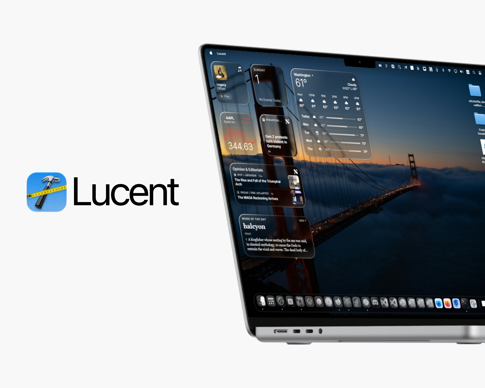

<p align="center">
  
</p>

<h1 align="center">Lucent</h1>

<p align="center">
  Tauri-based widget engine for Windows.
</p>

<p align="center">
  
  
  
  
  
  
</p>

---

> [!IMPORTANT]
> Lucent is early software and there are known bugs. Expect issues.

> [!WARNING]
> The code and app itself in this project was not written by AI. I did however used Claude's linux sandbox to test it and check for issues and bugs. App itself is proudly AI-free code while bug fixes and performance issues were AI-tested.

> [!CAUTION]
> Lucent is an independent project. It is not affiliated with or endorsed by Apple.


## Requirements

Windows 10 1809 or higher with the WebView2 runtime. 

Windows 11 ships with WebView2 preinstalled.

## Build (For Advanced Users)

You need Node.js LTS, Rust, and the Visual Studio Build Tools with the C++ workload.

```
npm install
npm run overlay            # run in development
npm run overlay:portable   # single exe: src-tauri/target/release/lucent.exe
npm run overlay:bundle     # NSIS installer
```

Other scripts: `npm run typecheck`, `npm run lint`, `npm run overlay:build` (front end only).

## Using it

Lucent configuation lives in the system tray. Open Settings from the tray icon to configure.

Settings are stored in `%APPDATA%\com.lucent.app`.

## Custom widgets

A widget is one `.widget.html` file in `%APPDATA%\com.lucent.app\widgets`. It shows up under **My Widgets** in the gallery, and saving the file reloads every copy on your desktop. `src-tauri/widgets/_template.widget.html` is a documented starting point.

Settings are `<meta>` tags: `widget-name`, `widget-description`, `widget-size`, `widget-interactive`, `widget-family`, `widget-fields`. Inside the page you get a small `glass` object:

```js
glass.ready((g) => {
  g.size;                     // 'S' | 'M' | 'L' | 'XL' | 'XXL'
  g.dark;                     // current appearance
  g.on('system', (s) => {});  // CPU, memory and disk numbers every second
  g.storage.set('k', 1);      // saved per widget
});
```

Widgets run in a sandboxed iframe with no access to your files or the app. They can make `https:` requests and nothing else.

> [!IMPORTANT]
> HTML custom widgets (`.widget.html`) will be removed in a possible future release and replaced with TypeScript widgets. Built-in and custom widgets will then share one system, which opens up for more features and possibily a "Widgy" alternative for windows. Any HTML widgets you made that uses the older HTML system will need to be rewritten.

## Built-in widgets

Each built-in widget is one TypeScript file in `src/widgets/`. Copy `src/widgets/_template.ts` to add one. Files starting with `_` are shared helpers.

## License

MIT, see [`LICENSE`](LICENSE).

## Credits

The glass effect uses a vendored copy of [ybouane/liquidglass](https://github.com/ybouane/liquidglass) (MIT). Lucent started from Liquid Glass Studio by Charles Yin (MIT).
